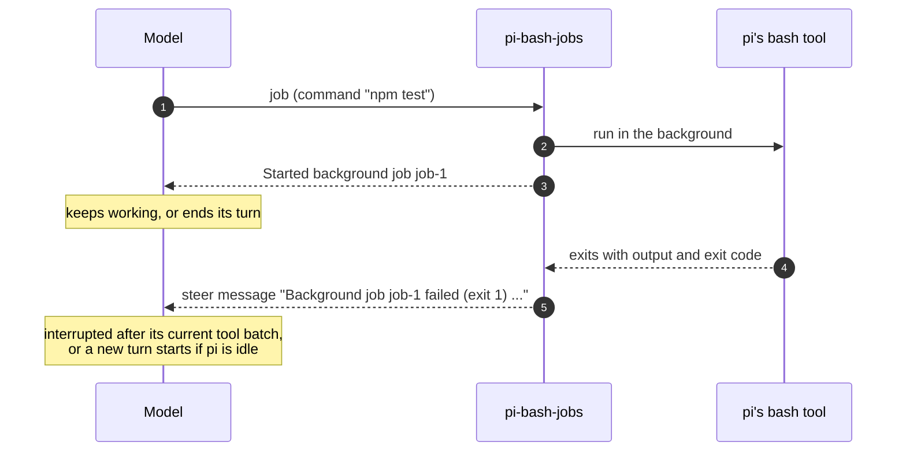

<div align="center">

# pi-bash-jobs

**Run slow shell commands in the background. Get interrupted when they finish.**

A [pi](https://pi.dev) extension that gives the agent background jobs, built on pi's own `bash` tool.

[](https://github.com/k4zunoko/pi-bash-jobs/actions/workflows/ci.yml) [](https://github.com/k4zunoko/pi-bash-jobs/releases/latest) [](#compatibility) [](LICENSE)

[Quick start](#quick-start) · [Usage](#usage) · [Security](#security) · [Reference](docs/reference.md) · [Changelog](CHANGELOG.md)

</div>

---

Ask an agent to run your test suite and it sits in a `bash` call until the suite is done. With pi-bash-jobs it starts the command as a **job**, gets a job id back right away, and keeps working. When the command finishes, its output arrives as a message that interrupts the agent after its current tool batch, or starts a new turn if pi is idle.

| | `bash` | `job` |
|---|---|---|
| Returns | When the command exits | Immediately, with a job id (`job-1`) |
| While the command runs | The agent waits | The agent keeps working, or ends its turn |
| The result arrives | As the tool result | As a message that interrupts the agent, or starts a new turn when pi is idle |
| Shell, environment, `timeout`, output truncation | pi's bash tool | The same pi bash tool |

## Highlights

- **Runs like `bash`.** Jobs go through pi's own bash tool with your `shellPath` and `shellCommandPrefix` settings: same shell (Git Bash on Windows), `PI_*` environment variables, `timeout`, process-tree kill, and output truncation (last 2000 lines / 50KB, with the full output in a temp file).
- **No sleeping, no polling.** The result is delivered as a steer message, and the tools tell the model to keep working, or to end its turn, instead of waiting.
- **Looks like `bash`.** A finished job is drawn as a finished `bash` row (`$ npm test · job-1`, output preview, `Took …`), and display extensions that restyle bash rows apply to it too.
- **Works headless.** In print and JSON mode (`pi -p`, `pi --mode json`), pi waits for running jobs before it exits, so their results reach the model.
- **Nothing left dangling.** Quitting, `/reload` or switching sessions kills running jobs and records each one in the conversation.
- **Does not bypass sandboxes.** When an extension replaces `bash` (OS sandbox, SSH, spawn hook), `job` refuses to start instead of running the command locally.
- **You stay in control.** `/jobs` lists, tails and kills jobs, and the footer shows how many are running.

## Contents

- [Quick start](#quick-start)
- [How it works](#how-it-works)
- [Usage](#usage): [tools](#tools), [`/jobs` command](#jobs-command), [completion message](#completion-message)
- [Modes](#modes)
- [Session end](#session-end)
- [Security](#security)
- [Compatibility](#compatibility)
- [Limitations](#limitations)
- [FAQ](#faq)
- [Install and update](#install-and-update)
- [Documentation and contributing](#documentation-and-contributing)

## Quick start

**1. Install** the package from GitHub (requires pi 1.1.0 or later):

```bash
pi install git:github.com/k4zunoko/pi-bash-jobs
```

**2. Start pi** (or run `/reload` in a running session) and ask for something slow:

```text
Run the full test suite, and fix the lint warnings in src/ while it runs.
```

**3. Keep going.** The agent calls `job` with `npm test`, gets `job-1` back, and works on the lint warnings. When the tests exit, the result interrupts it after its current tool batch:

```text
Background job job-1 failed (exit 1) after 1m4s: npm test

<the last lines of the test output>

Command exited with code 1
```

> [!TIP]
> To try it for one run without installing it, load it with `-e`: `pi -e git:github.com/k4zunoko/pi-bash-jobs`. Do not combine this with an installed copy, or the same tools are registered twice.

## How it works



- **Execution is pi's own bash tool.** Each job runs through `createBashToolDefinition(cwd, { shellPath, commandPrefix })`, created with the `shellPath` and `shellCommandPrefix` settings the way pi creates the built-in `bash` tool. The differences from `bash`: a job reads the settings when it starts (the built-in tool reads them when the session starts or reloads), `job` refuses to start while an extension replaces `bash`, and `tool_call` guards on `bash` do not see a job's command (see [Security](#security)).
- **Completion is a steer message.** `pi.sendMessage(..., { triggerTurn: true, deliverAs: "steer" })` interrupts a running agent after its current tool batch, or starts a new turn when pi is idle.
- **Completion is drawn as a bash tool row,** using pi's own `ToolExecutionComponent` and the bash tool's renderers. See [Rendering](docs/reference.md#rendering) for what display extensions can and cannot change.
- **No interactive shell, no PTY, no persistence.** Jobs live as long as the session runtime (see [Session end](#session-end)).

## Usage

You rarely call anything yourself: the agent decides when to use a job. You watch and steer with [`/jobs`](#jobs-command) and the footer.

### Tools

| Tool | What it does |
|---|---|
| `job { command, timeout? }` | Start a background job and return its id (`job-1`, `job-2`, ...) immediately. An invalid `timeout` (not a positive number, or over 2147483.647 seconds) or a missing working directory is an error result, and no job starts ([all errors](docs/reference.md#job)). |
| `jobs { id?, tail? }` | Read-only. List the running jobs (id, elapsed time, `killing` state, command), or with `id`, also show the last `tail` lines (default 20, at most 500) of that job's output so far, and the full output file once the output is truncated. |
| `kill_job { id }` | Kill a running job and its child processes, wait up to 5 seconds for it to exit, and return its output so far. |

The model reads the text result. Programmatic callers such as codemode scripts get a structured result, which the tools declare with an `outputSchema`:

| Tool | Structured result (`structuredContent`) |
|---|---|
| `job` | `{ id, command }` |
| `jobs` | `{ jobs: [{ id, command, state, elapsed_seconds, timeout? }], output? }` |
| `kill_job` | `{ id, exited, status, exit_code?, output }`, where `status` is `done`, `failed`, `killed`, or `killing` (not exited yet) |

A job killed by the agent is reported only in the `kill_job` result, with no extra message. If the job does not exit within 5 seconds, `kill_job` returns an error result (`exited: false`). The job then stays listed as `killing`, and when it finally exits, its output is recorded in the conversation without waking the agent (the header notes how long it took to exit after the kill).

<details>
<summary><b>Example:</b> start a job, look at it, kill it</summary>

<br>

`job` with `{ "command": "npm run build", "timeout": 600 }`:

```text
Started background job job-2: npm run build
A message will arrive when it finishes. Continue with other work.
```

`jobs` with `{ "id": "job-2", "tail": 3 }`:

```text
job-2 (2m10s): npm run build
Output so far (last 3 lines):
[1/3] Compiling
[2/3] Bundling
[3/3] Minifying
```

`kill_job` with `{ "id": "job-2" }`:

```text
Background job job-2 was killed after 2m12s: npm run build

[1/3] Compiling
[2/3] Bundling
[3/3] Minifying


Command aborted
```

The output is pi's bash tool output, so a failed, killed or timed-out job ends with the same status line as a `bash` call (`Command exited with code N`, `Command aborted`, `Command timed out after N seconds`).

</details>

<details>
<summary><b>What the model is told</b></summary>

<br>

The tools add these guidelines to the system prompt:

- Run builds, test suites and other slow commands as jobs and keep working on something else, instead of sleeping or polling.
- When nothing else is left to do while a job runs, end the turn: the result arrives as a new message and starts a new turn.
- Do not run the same command again with `bash` while its job runs.
- Stop jobs that are no longer needed with `kill_job`.
- Use `jobs` only to decide what to do about a running job (for example, whether it is stuck), not to poll for its completion.

The exact wording is in the [reference](docs/reference.md#prompt-guidelines).

</details>

### `/jobs` command

| Command | Description |
|---|---|
| `/jobs`, `/jobs list` | List running jobs. Jobs that were sent a kill but have not exited yet are marked `killing`. |
| `/jobs show <id> [lines]` (or `tail`) | Show the last lines (default 20, at most 500) of a running job's output so far. |
| `/jobs kill <id>...` | Kill one or more jobs, waiting up to 5 seconds for each to exit. Unknown ids get a warning. |
| `/jobs kill all` | Kill every running job. |

```text
/jobs
job-1 (12.3s): npm test
job-2 (1m4s, killing): make ⏎ make install
```

A kill from `/jobs` is recorded in the conversation without waking the agent. Jobs that exited are reported as `Killed`; jobs that have not exited yet get a warning and stay listed as `killing` until they do. Argument completion offers `list`, and `show <id>`, `kill <id>` and `kill all` for the running jobs.

While jobs are active, the footer shows their count, for example `jobs: 2 running` or `jobs: 1 running, 1 killing`.

### Completion message

A finished job is added to the conversation as a custom message. Its content is what the model reads:

```text
Background job job-1 failed (exit 2) after 1m4s: npm test ⏎ npm run lint

<output of the bash tool: the last 2000 lines / 50KB, a truncation note with the full output path, and the status line>
```

- **The first line is the header,** and it is always one line. The command in it is a summary: lines joined with ` ⏎ `, cut to 80 characters with `…`. A blank line separates it from the output. The `/jobs` list and the `job` result show the same one-line summary.
- **The header says how the job ended:** `finished`, `failed (exit N)`, `timed out after … (timeout Ns)`, `was killed`, `failed` (the command could not run, for example a spawn error), or `was interrupted after … because …` (the session ended, see [Session end](#session-end)).
- **Durations** read `12.3s`, `1m4s`, `1h2m5s`.

> [!NOTE]
> **For extension authors:** the message has `customType: "bash-jobs"`, and its `details` (type `BashJobMessageDetails`, exported from [`src/index.ts`](src/index.ts)) carry the id, full command, timeout, `status`, `reason`, exit code, duration and the bash tool's truncation details. Fields are only added, not renamed or removed, without a breaking release noted in the [CHANGELOG](CHANGELOG.md); the same holds for `customType` and the header line. See the [field list and compatibility rules](docs/reference.md#completion-message).
>
> To follow the jobs from another extension, for example to tell that an idle pi will continue when a job ends, listen to the `bash-jobs:status` event on `pi.events`. It carries the number of jobs that will wake the agent and of jobs being killed, in every mode. See [Status event](docs/reference.md#status-event).

## Modes

| Mode | Behavior |
|---|---|
| Interactive (`pi`) | The completion interrupts the agent after its current tool batch, or starts a new turn when pi is idle. |
| RPC (`pi --mode rpc`) | Same as interactive. When pi is idle, the completion starts a new run that the client receives like any other. |
| Print (`pi -p`) and JSON (`pi --mode json`) | These modes exit when the run settles, which would kill running jobs. Instead, when the model ends its turn while jobs are running, the run waits at its last boundary (`agent_before_settle`) until they finish. Their results reach the model in the same invocation, it continues, and pi exits after that. Jobs that were killed are not waited for. |

> [!WARNING]
> In print and JSON mode, pi waits as long as a job runs. Give commands that might not finish a `timeout`.

## Session end

A session runtime ends when pi quits, on `/reload`, and when you switch to a new, resumed or forked session. Running jobs are then killed, and pi waits up to 5 seconds (in total) for them to exit before it continues. Each job gets one message in the conversation of the session that ran it, without waking the agent:

```text
Background job job-3 was interrupted after 42.0s because the session was reloaded: npm test

<output so far>
```

The message has `status: "killed"` and `reason: "interrupted"`. A job that did not exit within the wait is recorded with its latest output and a note that it may still be running. So after a reload or `pi -c`, the conversation does not keep a job that waits for a result that will not come.

Job ids continue across runtimes: a new runtime starts numbering after the highest `job-N` in the current branch, so an old `job-1` in the conversation and a new job never share an id.

## Security

> [!WARNING]
> `job` runs shell commands with the same power as `bash`, but it is a separate tool, and it runs pi's built-in bash implementation directly instead of calling the tool named `bash`. Extensions that redirect or guard `bash` therefore do not automatically cover jobs. The extension handles the two cases differently, because only one of them can be detected.

### Replacements of `bash` are detected, and `job` refuses to run

Extensions that replace the `bash` tool run commands in an OS sandbox ([`sandbox/`](https://github.com/earendil-works/pi/tree/main/packages/coding-agent/examples/extensions/sandbox)), on a remote host ([`ssh.ts`](https://github.com/earendil-works/pi/blob/main/packages/coding-agent/examples/extensions/ssh.ts)), or with a spawn hook that rewrites the command or environment ([`bash-spawn-hook.ts`](https://github.com/earendil-works/pi/blob/main/packages/coding-agent/examples/extensions/bash-spawn-hook.ts)). A job would run on the local machine with pi's built-in bash and bypass them.

Before each job starts, `job` checks where the `bash` tool comes from (`pi.getAllTools()`, `sourceInfo`). If an extension registered it instead of pi, `job` returns an error result that names the extension and tells the model to use `bash`, and no job starts. In the TUI and RPC modes, the user also gets a warning when the session starts.

- A pi without `getAllTools` (older than the supported 1.1.0) cannot be checked, and jobs run there as before.
- There is no switch to allow jobs anyway, so this also applies to an extension that re-registers `bash` only to change how it looks.

### Guards on `bash` cannot be detected

`tool_call` and `tool_result` handlers that check `event.toolName === "bash"`, such as permission gates, confirmations and command filters (pi's [`permission-gate.ts`](https://github.com/earendil-works/pi/blob/main/packages/coding-agent/examples/extensions/permission-gate.ts) example), never see a job's command, and extensions cannot list other extensions' handlers. Such a guard does see the `job` call itself, so extend it to `job`, where the command is `event.input.command`:

```ts
pi.on("tool_call", (event) => {
  if (event.toolName !== "bash" && event.toolName !== "job") return undefined;
  const command = String(event.input.command);
  if (/\brm -rf\b/.test(command)) return { block: true, reason: "Dangerous command blocked" };
  return undefined;
});
```

[`test/security.test.ts`](test/security.test.ts) runs this guard in a real pi session and checks that it blocks the job before it starts.

If you cannot change the guard, turn the job tools off for a run with `pi --exclude-tools job,kill_job`, or do not load this package in that setup (`pi remove`, or a package entry with `"extensions": []`, see pi's [package docs](https://github.com/earendil-works/pi/blob/main/packages/coding-agent/docs/packages.md#select-package-resources)).

### Tool annotations

The tools declare [annotations](https://github.com/earendil-works/pi/blob/main/packages/coding-agent/docs/extensions.md#tool-exposure) for permission extensions that decide from them:

| Tool | Annotations | Why |
|---|---|---|
| `job` | `destructiveHint: true`, `openWorldHint: true` | Like a shell command |
| `kill_job` | `destructiveHint: false`, `idempotentHint: true`, `openWorldHint: false` | It only ends processes that `job` started |
| `jobs` | `readOnlyHint: true`, `openWorldHint: false` | It only reads job state |

<details>
<summary><b>Why jobs do not call the active <code>bash</code> tool</b></summary>

<br>

Running jobs through the active `bash` tool with `ctx.executeTool("bash")` would make both cases apply to jobs automatically. That is not done yet: in pi 1.1.0, a nested call that outlives the calling tool holds pi's shared queue while the agent runs tools sequentially, and stays recorded as unfinished on the tool result ([#7](https://github.com/k4zunoko/pi-bash-jobs/issues/7)).

</details>

## Compatibility

- **pi 1.1.0 or later.** The completion row uses the `outputPad` and `durationMs` render options added in pi 1.1.0, and the exit code comes from the bash tool's `structuredContent` (pi 0.99.0). Older versions are not tested.
- **Peer dependencies.** The pi packages and `typebox` are `peerDependencies` with a `"*"` range, as pi's [package docs](https://github.com/earendil-works/pi/blob/main/packages/coding-agent/docs/packages.md#declare-dependencies) require: pi provides its own copies at runtime and installs packages without peer resolution, so a version range there would not be checked. The minimum version is stated here instead.
- **Node.js.** `engines.node` (`>=22.19.0`) matches pi's own requirement. Development needs it too, because the tests run the `.ts` sources directly with Node's type stripping.

## Limitations

- **Commands must finish on their own.** The package is meant for builds and tests. Servers and watchers never complete, so they never notify.
- **Jobs do not survive the session runtime.** Quitting, `/reload`, and switching to a new, resumed or forked session kill them (see [Session end](#session-end)). If pi itself is killed (for example with `SIGKILL`) or crashes, there is no shutdown: nothing is recorded, and the job's processes may keep running.
- **Replaced `bash` and `bash` guards.** `job` is disabled while an extension replaces the `bash` tool (sandboxes, remote execution, spawn hooks), and `tool_call` guards on `bash` do not see a job's command. See [Security](#security).

> [!NOTE]
> **Windows (Git Bash):** killing a job can leave its child processes running (for example `sleep.exe`). MSYS starts children through intermediate processes that exit, so pi's `taskkill /T` cannot reach them. The built-in bash tool shares this behavior when aborted. Jobs that run to completion are not affected.

## FAQ

<details>
<summary><b>How many jobs can run at once?</b></summary>

<br>

There is no limit, as there is none on parallel `bash` calls. A fixed number would suit some machines and commands and not others, and an error from it would only make the model retry later. Running jobs are always visible in the footer and in `/jobs`, and you can kill them there.

</details>

<details>
<summary><b>Can I start a dev server or a file watcher as a job?</b></summary>

<br>

It starts, but it never finishes, so no result ever arrives, and in print and JSON mode pi would wait for it. Use jobs for commands that end on their own, and give commands that might hang a `timeout`.

</details>

<details>
<summary><b>What happens to running jobs on <code>/reload</code>?</b></summary>

<br>

They are killed, and each one is recorded in the conversation as `interrupted` with its output so far. See [Session end](#session-end).

</details>

<details>
<summary><b>Why does <code>job</code> say it is disabled?</b></summary>

<br>

An extension replaces the `bash` tool (for example a sandbox), and a job would run outside it. The error names that extension. Use `bash` in that setup. See [Security](#security).

</details>

<details>
<summary><b>How do I turn the job tools off for one run?</b></summary>

<br>

`pi --exclude-tools job,kill_job`. To stop loading the package, `pi remove git:github.com/k4zunoko/pi-bash-jobs`.

</details>

<details>
<summary><b>Does my display extension restyle job rows?</b></summary>

<br>

Extensions that restyle bash rows by patching `ToolExecutionComponent` apply to finished jobs too. Renderers registered with `pi.registerToolRenderer` for `bash` are not consulted. See [Rendering](docs/reference.md#rendering).

</details>

## Install and update

```bash
# Install the latest version from main
pi install git:github.com/k4zunoko/pi-bash-jobs

# Update it
pi update git:github.com/k4zunoko/pi-bash-jobs

# Remove it
pi remove git:github.com/k4zunoko/pi-bash-jobs
```

To pin a release, install one of the [release tags](https://github.com/k4zunoko/pi-bash-jobs/releases) (`v<x.y.z>`). Updates then keep that version until you install another tag:

```bash
pi install git:github.com/k4zunoko/pi-bash-jobs@v<x.y.z>
```

Add `-l` to `pi install` to write the package to the project's `.pi/settings.json` instead of your personal settings (pi loads it there once project trust is granted). Releases and breaking changes are listed in [CHANGELOG.md](CHANGELOG.md).

For development, run `pi -ne -e ./src/index.ts` from a clone, so the installed copy does not register the same tools twice. See [CONTRIBUTING.md](CONTRIBUTING.md).

## Documentation and contributing

| Document | Contents |
|---|---|
| [docs/reference.md](docs/reference.md) | Full reference: tool parameters and errors, `/jobs`, the status event, the completion message fields, rendering, kills, session end, exported API |
| [CONTRIBUTING.md](CONTRIBUTING.md) | Development setup, tests, CI and the release process |
| [CHANGELOG.md](CHANGELOG.md) | Releases and breaking changes |

Bug reports and ideas are welcome in [issues](https://github.com/k4zunoko/pi-bash-jobs/issues).

## License

[MIT](LICENSE) © k4zunoko
